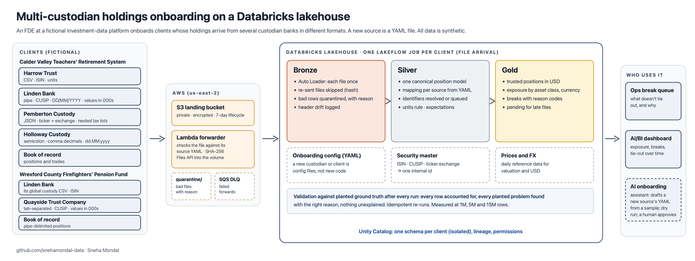

# Holdings Onboarding Lakehouse

> **Everything here is synthetic.** Keelstone, the Calder Valley Teachers' Retirement System and the three custodian banks (Harrow Trust, Linden Bank, Pemberton Custody) are fictional. No real bank, client or fund data is used.



A forward-deployed engineer at a fictional investment-data platform onboards a client whose holdings arrive from three custodians in three formats. Onboarding a new source should be a YAML file, not new code. Full spec: [docs/PROJECT_SPEC.md](docs/PROJECT_SPEC.md).

## Status

| Slice | What | Status |
|---|---|---|
| 1 | Data in: generator with planted problems, landing volume, bronze via Auto Loader, quarantine | done |
| 2 | Silver: config-driven mapping to one position model, security master resolution, units rule, dedupe | done |
| 3 to 8 | Gold, orchestration and onboarding by config, scale, AWS, AI assistant, docs | not started |

## Layout

```
config/clients/<client>.yml     which sources a client has, and its Unity Catalog schema
config/sources/<source>.yml     format, delimiter, columns, quarantine rules, header aliases
src/keelstone/generator/        fixed-seed generator that plants every problem in spec section 3
src/keelstone/ingest/           generic bronze ingest (one Auto Loader stream per configured source)
src/keelstone/silver/           silver mapping (config to SQL), pipeline definitions, local mirror
pipelines/                      Lakeflow declarative pipeline source (thin; logic is in the wheel)
src/keelstone/qa/               where ground truth lives; pipeline code may not import it
jobs/                           Databricks notebooks: setup, ingest, validation
resources/                      Lakeflow Job definitions (bundle)
scripts/                        generate, deliver (upload by delivery date), build wheel, deploy
tests/                          local pytest (plain Python, no Spark needed)
```

## Run it

```bash
python3 -m venv .venv && .venv/bin/pip install -r requirements-dev.txt
.venv/bin/python -m pytest                                   # local tests

.venv/bin/python scripts/generate.py --seed 42               # data/landing + data/ground_truth
databricks auth login --host <workspace-url> --profile keelstone
.venv/bin/python scripts/deploy.py                           # wheel + configs to a volume, bundle deploy
.venv/bin/python scripts/deliver.py --ground-truth           # ground truth to keelstone.qa only
.venv/bin/python scripts/deliver.py --through 2026-07-14     # files "arrive" by delivery date
python scripts/run_job.py slice1_bronze                      # setup, ingest, re-run (must add 0 rows), validate
python scripts/run_job.py slice2_silver                      # silver update, re-run, full refresh, validate
```

## Design notes for slice 1

- **Bronze is config-driven.** `ingest_bronze` reads the client YAML and starts one Auto Loader stream per listed source from that source's YAML. No source-specific code.
- **Exactly once.** Auto Loader checkpoints load each file path once. A file re-sent under a new name is caught by a SHA-256 of its bytes and logged as `duplicate_content`. Every Delta write uses `txnAppId`/`txnVersion`, so a retried micro-batch is not written twice.
- **Nothing silently dropped.** Every row lands in the source's bronze table or in `bronze_quarantine` with a reason (`malformed_record`, `missing_required:<col>`, `not_numeric:<col>`, `bad_date:<col>`). Every file gets one row in `bronze_file_log`.
- **Schema drift keeps loading.** Columns are matched by header name. Unknown columns go to `_rescued_data` and are logged per file in `bronze_schema_drift_log`. A known rename is mapped by a `column_aliases` entry in the source YAML.
- **Ground truth stays out of the pipeline.** It lives locally in `data/ground_truth/` and in the `keelstone.qa` volume. A test fails if ingest (or later silver and gold) code references it. Only validation jobs read it.

## Design notes for slice 2

- **Silver is a Lakeflow declarative pipeline.** A check on Free Edition showed a serverless pipeline installs the project wheel from the volume (`environment.dependencies`), loads its source file, records expectation counts in the event log, and AUTO CDC (the pipeline form of MERGE) keeps re-runs unchanged. So silver uses one pipeline rather than plain PySpark jobs.
- **Mapping is config.** Each source YAML has a `silver:` section: which bronze column feeds each canonical field, the identifier type and columns, and the units multiplier. Dates use the format already in `rules.dates`. Pemberton's quantity is `lots[].quantity`, summed per position. Linden's renamed headers are `header_versions` in its YAML; bronze aliases are derived from them and every silver row records its `header_version`.
- **One position model.** `silver_positions`: client_id, source_id, position_side, account_id, security_id, business_date, quantity, price, market_value (local currency, after the multiplier), currency, identifier_type, identifier, header_version, source_file. Natural key: client, source, account, security, business date. The book of record maps into the same model (no price or value; gold values it).
- **Security master resolution.** `silver_identifier_map` maps ISIN, CUSIP, ticker:exchange and security_id to one security_id. An identifier with no match, or more than one, goes to `unresolved_securities` with its source and identifier, never dropped.
- **Units rule.** A row whose market value / (quantity x price) is between 500 and 2000, or between 0.0005 and 0.002, is quarantined in `silver_quarantine` with reason `units_scale_suspect`.
- **Dedupe.** Identical rows within a file are collapsed by the natural-key MERGE; `silver_dedupe_log` records how many per file. `silver_key_conflicts` lists any natural key seen with different content, and must stay empty.
- **Accounting.** For every file: bronze rows = silver + silver quarantine + unresolved + deduped. The Slice 2 job checks this, compares each part with the ground truth, and proves idempotency by snapshotting every silver table after an update, a re-run and a full refresh.

## Databricks Free Edition notes

- Serverless only, no retries in dev, small data steps, so a quota error stops the run rather than looping.

### Workspace-file limitation and the wheel-in-a-volume workaround

**Limitation.** On this Free Edition workspace, serverless compute could not reliably read bundle files under `/Workspace`. A `spark_python_task` script, and in one run an `import` of a module from the bundle's `src/`, failed with `OSError: [Errno 5]` (a 403 from workspace storage). The same files read fine through the API, and retries failed the same way, so it is a platform issue rather than our code. Notebook tasks load fine, and Unity Catalog volumes read and write reliably.

**Workaround.** `scripts/deploy.py` builds a wheel of `src/keelstone` (standard library only) and uploads it, with `config/`, to the volume `keelstone.platform.artifacts`, then runs `databricks bundle deploy`. Every job task is a notebook whose first cell is `%pip install` of that wheel, and it reads YAML from the volume. Onboarding a new source is still config only: edit YAML, run `deploy.py`.
